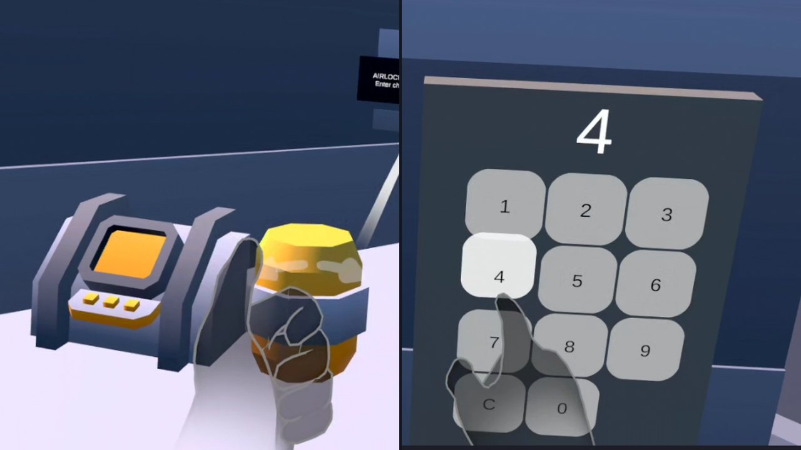

Demo video: https://youtu.be/DZ5hWwO5Y6s

# Orbital Station VR

Meta Quest VR puzzle game built with Unity, C#, and the Meta XR SDK.
Players move through one orbital-station hall with four stations, solving station-systems puzzles (airlock, power, greenhouse, command deck) with Quest controllers or hand tracking.
Built as a solo project to practice VR interaction design, state-machine-driven puzzle logic, and testable gameplay code.

## Tech

- Unity 6000.3.5f2, Universal Render Pipeline (URP)
- Meta XR SDK (Core, Interaction SDK, Interaction SDK Essentials) 207.0.1, OpenXR
- Target: Meta Quest. Controllers and hand tracking, teleport locomotion (no smooth locomotion)
- Performance: stable 72 FPS on Meta Quest (checked with the Meta Performance Overlay during a full run).
- Tests: 73 NUnit edit-mode tests covering the gameplay logic.

## Architecture

- **Assembly layers** (asmdef per layer, events between layers, no XR code in Core):
  - `Orbital.Core`: plain C# gameplay logic (puzzle state machine, mission/score tracking), no Unity XR dependencies
  - `Orbital.Activities`: the four station puzzles, built on top of Core
  - `Orbital.Interaction`: Meta Interaction SDK wiring
  - `Orbital.UI`: in-world UI (mission panel, feedback)
  - `Orbital.Audio`: sound effects (`AudioFeedback`)
  - `Orbital.Core.Tests`: NUnit edit-mode tests for Core logic
- **`PuzzleBase`**: shared state machine every puzzle (`KeypadPuzzle`, `BriefingPuzzle`, `GreenhousePuzzle`, `PowerCellPuzzle`, `CommandDeckPuzzle`) derives from.
- **`MissionManager`**: tracks overall mission progress across puzzles.
- **`ScoreService`**: plain C# scoring (see Scoring below), no Unity dependencies, fully unit-testable.
- **Plain C# logic classes** (`KeypadLogic`, `LeverLogic`, `SequenceLogic`, `SortingLogic`, `SocketTracker`): puzzle-specific logic extracted from MonoBehaviours so it can be covered by NUnit tests in `Assets/Project/Tests`.
- **`PuzzleInfo`**: ScriptableObject describing each puzzle's metadata (`Assets/Project/ScriptableObjects/PuzzleInfo/`), one asset per puzzle.

## How to open and run

1. Open the project in Unity 6000.3.5f2 with the Android Build Support module installed.
2. Open `Assets/Project/Scenes/01_OrbitalStation.unity`. It is the only scene in Build Settings.
3. **Play in the Editor with the XR Simulator:** enable Meta XR Simulator and press Play. Use the Simulator's on-screen controls to move the simulated headset and controllers.
4. **Build to Quest:** open File > Build Profiles, select Meta Quest and click Switch Platform. Connect a Quest device via USB with Developer Mode enabled, then Build and Run.

## Scoring

- Solving a puzzle awards 100 points, minus 10 points per hint requested while solving that puzzle (floored at 0).
- A full run with no hints scores 400.
- Hint and solve counts are tracked per puzzle via `ScoreService`, which also tracks total puzzles solved across the mission.

## AI-use note

Built with AI assistance (Claude Code) for scaffolding and review; design, integration and testing by me.